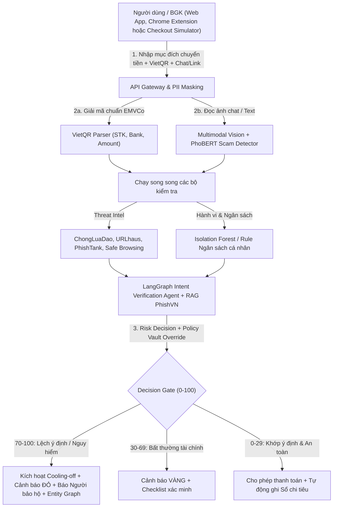

# ĐỀ ÁN CHI TIẾT: VÍ AN TÂM × PAYGUARD AI (PHƯƠNG ÁN B)

**Tên đầy đủ:** Ví An Tâm — Trợ lý Tài chính Cá nhân & Khiên Kiểm định Ý định Giao dịch (PayGuard AI)  
**Phạm vi chủ đề (`topic.md`):** Trợ lý AI (Trợ lý tài chính & thanh toán) + An ninh mạng + Chống lừa đảo  
**Hình thức triển khai:** Web App (PWA) + Chrome Extension (Manifest V3) + Payment Checkout Simulator API (chạy trực tuyến 100%, không phụ thuộc máy local)

---

## 1. Ý tưởng tổng quan & Giá trị cốt lõi

### 1.1. Bối cảnh & Bài toán thực tế tại Việt Nam
Các hình thức lừa đảo tài chính hiện đại tại Việt Nam chủ yếu thuộc nhóm **Authorized Push Payment (APP) Fraud**: nạn nhân không bị hack mật khẩu, mà bị **thao túng tâm lý** qua Zalo, Telegram, Facebook hoặc SMS (giả danh công an, thuế, điện lực, tuyển cộng tác viên, lừa cọc mua hàng) rồi tự tay quét mã **VietQR** và xác thực sinh trắc học để chuyển tiền.
* Hệ thống **SIMO** của Ngân hàng Nhà nước và **Quyết định 2345/QĐ-NHNN** bảo vệ rất tốt ở tầng tài khoản ngân hàng (danh sách đen STK và sinh trắc học chính chủ), nhưng **chưa đọc được ngữ cảnh dẫn dụ trước giao dịch**.
* Vì vậy, khoảng trống lớn nhất hiện nay là cần một **Lớp kiểm định ý định giao dịch (Transaction Intent Verification)** đứng *ngay trước bước chuyển tiền* để đối chiếu xem: *"Điều người dùng nghĩ mình đang trả tiền có khớp với bản chất thực tế của giao dịch và ngữ cảnh tin nhắn hay không?"*

### 1.2. Ý tưởng giải pháp & Vị trí triển khai thực tế (Trả lời bài toán tích hợp)
Để đáp ứng tiêu chí **"sản phẩm dùng được trực tuyến ngay hôm nay"** của [topic.md](file:///d:/Study/MyProject/Testkiro/topic.md) mà không vướng chính sách cấm của Google Play (`AccessibilityService`) hay giới hạn API đóng của các app ngân hàng, **Ví An Tâm × PayGuard AI** KHÔNG đóng vai một ví giữ tiền giả lập, mà được triển khai ở **03 điểm chạm hợp pháp và chạy thật 100%**:
1. **Web Guard Portal (PWA):** Người dùng dán tin nhắn, link lạ, tải lên ảnh chụp màn hình đoạn chat Zalo/SMS kèm ảnh mã **VietQR** trước khi mở app ngân hàng để AI kiểm định trong 3 giây.
2. **Chrome Extension (MV3):** Tích hợp trực tiếp trên trình duyệt máy tính (Zalo Web, Facebook Web, trang thanh toán TMĐT), tự động cảnh báo khi phát hiện link phishing hoặc kịch bản thao túng trước lúc người dùng quét mã QR trên màn hình.
3. **Checkout Middleware Simulator (B2B2C SDK Demo):** Mô phỏng cách PayGuard AI được tích hợp như một bước *Pre-Payment Check* bên trong cổng thanh toán/ví điện tử đối tác (nơi BGK có thể trực tiếp thực hiện giao dịch thử kèm ngữ cảnh chat để kiểm chứng cơ chế phát hiện lệch ý định).

---

## 2. Hệ thống tính năng chi tiết

### 2.1. Nhóm tính năng Lõi (Bắt buộc cho MVP)

1. **Transaction Intent Verification (Kiểm định Ý định Giao dịch — Điểm sáng tạo cốt lõi):**
   * Người dùng nhập/nói ngắn gọn mục đích chuyển tiền (ví dụ: *"Đóng tiền xác minh định danh công an"* hoặc *"Trả tiền cọc thuê trọ"*), kèm ảnh chụp đoạn chat/tin nhắn và mã **VietQR**.
   * AI trích xuất cấu trúc giao dịch thật từ chuỗi **EMVCo VietQR** (tên ngân hàng, STK, số tiền, nội dung) rồi so sánh với ý định được khai báo và kịch bản chat: phát hiện ngay mâu thuẫn (ví dụ: *xưng là cơ quan công an/thuế nhưng tài khoản thụ hưởng là cá nhân*, *khớp mẫu kịch bản hối thúc chuyển gấp*).
2. **Scam Message & Link Scanner (Đa tầng Threat Intelligence):**
   * Phân loại tin nhắn/ảnh chat tiếng Việt dựa trên mô hình NLP kết hợp RAG trên dữ liệu **PhishVN**, `vietnamese_sms_phishing_sample` và `hoangvt2501/data_scam`.
   * Tra cứu song song đường link/domain qua `api.chongluadao.vn`, **URLhaus API**, **PhishTank API**, **Google Safe Browsing**.
3. **Personal Finance Copilot & Spending Anomaly (Trợ lý Tài chính Cá nhân):**
   * Quản lý ngân sách theo hạng mục, thiết lập **Hạn mức an toàn ngày** và ghi nhận lịch sử giao dịch đã kiểm duyệt.
   * Phát hiện bất thường dòng tiền cá nhân (ví dụ: chuyển số tiền lớn gấp nhiều lần mức chi tiêu trung bình tới một tài khoản mới hoàn toàn chưa từng giao dịch).
4. **Cooling-off & Dual-Approval Shield (Làm nguội tâm lý & Bảo vệ người lớn tuổi):**
   * Khi điểm rủi ro vượt ngưỡng (Risk Score >= 70) hoặc phát hiện dấu hiệu thao túng khẩn cấp, hệ thống kích hoạt **đồng hồ đếm ngược làm nguội 30–60 giây**, kèm câu hỏi phản biện thực tế (*"Tài khoản nhận mang tên cá nhân, không phải tổ chức bạn đang liên hệ"*) và nút **gửi cảnh báo tóm tắt cho Người bảo hộ (Telegram/Email)** xác nhận chéo.

### 2.2. Nhóm tính năng Nâng cao / Điểm nhấn (Differentiators)

5. **Natural Language Policy Vault ("Két sắt Chính sách" Gia đình):**
   * Con cái/người bảo hộ thiết lập quy tắc bảo vệ bằng tiếng Việt tự nhiên cho người lớn tuổi (ví dụ: *"Cảnh báo đỏ mọi giao dịch trên 3 triệu nếu kèm tin nhắn chứa từ khóa 'nâng cấp sim', 'hoàn thuế', 'trúng thưởng'"*).
6. **Mini Risk Entity Graph (Đồ thị liên kết thực thể lừa đảo):**
   * Trực quan hóa mối liên hệ giữa các yếu tố trích xuất được (`SĐT nghi vấn` — `Domain giả mạo` — `STK VietQR` — `Loại kịch bản`) giúp người dùng nhìn thấy bức tranh toàn cảnh của bẫy lừa đảo.
7. **Unified MCP Tool Layer:**
   * Đóng gói các công cụ kiểm tra QR, tra cứu Threat Intel và truy vấn ngân sách thành **MCP Server** để LangGraph Agent gọi thống nhất, minh bạch và dễ mở rộng sang các đối tác ví điện tử.

---

## 3. Cách sử dụng & Luồng trải nghiệm (User Flow & Demo Flow cho BGK)

### 3.1. Sơ đồ luồng vận hành

### 3.2. Kịch bản sử dụng & Hướng dẫn BGK tự kiểm thử trong 2 phút
BGK truy cập URL Web App (đính kèm trong file PDF 1 trang A4) và sử dụng ngay tài khoản demo:
* **Cách 1 — Dùng Web Guard với Bộ kịch bản 1-click (hoặc tự nhập):**
  1. BGK chọn kịch bản mẫu *"Giả danh shipper/công an gửi link + mã VietQR"* hoặc tự upload ảnh mã VietQR + dán đoạn chat bất kỳ.
  2. Hệ thống giải mã chính xác STK/Ngân hàng từ ảnh QR, quét link qua API Chống Lừa Đảo/URLhaus, chạy PhoBERT + LLM Intent Verification để phát hiện bẫy thao túng tâm lý.
  3. Màn hình bật chế độ **Cooling-off (đếm ngược cảnh báo đỏ)**, giải thích cụ thể sự mâu thuẫn trong ý định giao dịch, hiển thị Mini Entity Graph và cho phép bấm gửi cảnh báo thử tới kênh Người bảo hộ.
* **Cách 2 — Dùng Checkout Middleware Simulator:**
  * BGK thử thực hiện một giao dịch thanh toán mô phỏng trên giao diện Checkout tích hợp PayGuard SDK; thử chuyển khoản an toàn (hệ thống tự động phân loại và cộng vào biểu đồ ngân sách cá nhân) vs chuyển khoản bị dẫn dụ (hệ thống chặn trước khi xác nhận).
* **Cách 3 — Dùng Chrome Extension:**
  * Bôi đen một đoạn tin nhắn/link trên bất kỳ tab web nào, chuột phải chọn *"Kiểm tra với Ví An Tâm"* để xem kết quả chấm điểm ngay tại popup.

---

## 4. AI / LLM liên quan & Cách xây dựng hệ thống LLM

### 4.1. Bản đồ các mô hình AI & Nhiệm vụ

| Module trong hệ thống | Mô hình / Kỹ thuật sử dụng | Vai trò & Lý do lựa chọn |
| :--- | :--- | :--- |
| **Scam Message Detection** | **PhoBERT** *(hoặc XLM-RoBERTa fine-tuned)* + **RAG (`pgvector`)** | Xử lý cực tốt tiếng lóng, viết tắt, dấu thanh tiếng Việt trên tập *vietnamese_sms_phishing_sample* và *data_scam*; chạy nhanh ở tầng pre-filter để giảm tải chi phí cho LLM lớn. |
| **URL & Phishing Classifier** | **XGBoost / Random Forest** + **Threat Intel APIs** | Trích xuất đặc trưng lexical của URL (độ dài, ký tự lạ, giả mạo thương hiệu ngân hàng VN, tuổi domain) huấn luyện trên tập **PhishVN**, kết hợp tra cứu live với `api.chongluadao.vn`, URLhaus, PhishTank, Safe Browsing. |
| **Transaction Anomaly Detection** | **Isolation Forest** + **Rule Ngân sách** | Phát hiện giao dịch bất thường theo lịch sử cá nhân (số tiền đột biến, khung giờ đêm muộn, tần suất chuyển nhanh tới STK mới). |
| **Intent Verification & Copilot** | **Multimodal LLM (Gemini API)** điều phối qua **LangGraph** | Đọc ảnh chụp chat/QR, tổng hợp tín hiệu từ PhoBERT + XGBoost + Isolation Forest + Threat Intel, thực hiện **Intent Verification** theo Structured Output JSON Schema và trả lời hỏi đáp tài chính. |
| **Recipient Risk Mini-Graph** | **Graph Analytics (`NetworkX` / PostgreSQL Graph)** | Tính mức độ liên đới nếu STK hoặc URL đầu vào có liên kết với các thực thể từng bị báo cáo lừa đảo. |

### 4.2. Quy trình xây dựng hệ thống AI/LLM (Implementation Steps)

1. **Bước 1 — Chuẩn bị dữ liệu & Fine-tune tầng ML/NLP nhẹ:**
   * Tải và làm sạch 3 tập dữ liệu mở tiếng Việt: **PhishVN** (Mendeley Data), `trannguyenthaituan/vietnamese_sms_phishing_sample` (Hugging Face), `hoangvt2501/data_scam` (GitHub).
   * Chia train/val/test tách biệt tránh rò rỉ dữ liệu; huấn luyện **XGBoost** phân loại URL độc hại (trên đặc trưng lexical + TF-IDF ký tự) và fine-tune **PhoBERT** phân loại văn bản lừa đảo đa lớp (an toàn / giả danh cơ quan / lừa việc nhẹ / phishing ngân hàng).
   * Đưa embedding các kịch bản lừa đảo vào PostgreSQL (`pgvector`) để phục vụ RAG.
2. **Bước 2 — Xây dựng LangGraph Multi-Step Verification Workflow:**
   * Thiết kế `StateGraph` gồm các node:
     `Input_Sanitizer` -> [chạy song song `VietQR_Decoder`, `ThreatIntel_Node`, `PhoBERT_Node`, `Finance_Anomaly_Node`] -> `Intent_Verifier_LLM` -> `Policy_Override_Guard` -> `Response_Formatter`.
   * Dùng **Structured Output (Pydantic)** bắt buộc `Intent_Verifier_LLM` phải trả về: `stated_intent`, `detected_transaction_nature`, `intent_mismatch_score`, `manipulation_tactics[]`, `exact_evidence_quotes[]` (trích nguyên văn từ input để chống bịa đặt).
3. **Bước 3 — Thiết lập Guardrails & Rule Override:**
   * **Hard Override:** Nếu Threat Intel API dương tính hoặc vi phạm luật *Két sắt chính sách*, Backend ghi đè `risk_level = "HIGH"` bất kể LLM đánh giá thế nào.
   * **Anti-Prompt-Injection & PII Masking:** Gói toàn bộ tin nhắn/URL đầu vào trong thẻ `<untrusted_content>` kèm bộ lọc Regex che CCCD/OTP/tài khoản cá nhân trước khi gửi API LLM.
4. **Bước 4 — Đóng gói Serving tối ưu độ trễ:**
   * Model PhoBERT và XGBoost được export sang **ONNX Runtime** chạy trực tiếp trong container FastAPI (latency ~20–50ms/request), kết hợp Redis cache kết quả URL/domain để toàn bộ pipeline phản hồi dưới 2–3 giây.

---

## 5. Tech Stack & So sánh Trade-off với `MerchantOps AI`

* **Tech Stack khuyến nghị:** Next.js PWA + Chrome Extension MV3 (Frontend) | FastAPI + LangGraph + ONNX Runtime (PhoBERT/XGBoost) + scikit-learn (Isolation Forest) (Backend) | PostgreSQL + `pgvector` + Redis (Data/Cache) | Gemini API + `api.chongluadao.vn` + URLhaus + PhishTank + Safe Browsing | Deploy trên Vercel + Cloud Run/Render.

### Bảng đối chiếu Trade-off: `Ví An Tâm (x PayGuard)` vs `MerchantOps AI`

| Tiêu chí cân nhắc | Phương án B: `Ví An Tâm (x PayGuard)` | Phương án A: `MerchantOps AI` |
| :--- | :--- | :--- |
| **Bài toán & Đối tượng mục tiêu** | **B2C (Cá nhân, người lớn tuổi, người dùng fintech):** Chống lừa đảo thao túng tâm lý (APP Fraud) + Quản lý chi tiêu cá nhân. | **B2B / SME (Chủ shop online, hộ kinh doanh):** Tự động bán hàng + Đối soát VietQR thật + Chống bill giả & hóa đơn giả. |
| **Điểm nhấn sáng tạo nhất** | **Transaction Intent Verification** (so khớp ý định người dùng vs giao dịch thực tế) + **Cooling-off & Bảo hộ gia đình**. | **MCP Agentic Workspace** + **Phát hiện bill giả bằng ELA/Metadata kết hợp SePay Webhook thật**. |
| **Điểm mạnh kỹ thuật AI/ML** | Kết hợp chiều sâu cả **ML cổ điển (XGBoost, Isolation Forest) + NLP tiếng Việt (PhoBERT) + RAG + LangGraph**. | Mạnh về **Multimodal Document Forensics, Tool Use qua MCP, Policy Compiler**. |
| **Độ khó khi chứng minh "tính thực tế"** | **Cao hơn một chút:** BGK dễ đặt câu hỏi *"Người dùng đang vội trên app ngân hàng thì có nhớ mở web/extension để check không?"* -> Cần demo Extension + Checkout Simulator thật mượt để thuyết phục. | **Thấp hơn (Rất thực tế):** Chủ shop vốn vận hành đơn hàng trên Web + VietQR hằng ngày, SePay Webhook chạy thật nên tính ứng dụng ngay lập tức rất rõ ràng. |
| **Sức hút truyền thông / Thuyết trình** | **Rất mạnh về cảm xúc xã hội:** Đánh trúng vấn nạn lừa đảo qua Zalo/chuyển khoản mà hầu hết mọi người đều quan tâm. | **Rất mạnh về tính thương mại & "Future Workspace":** Rõ mô hình kinh doanh SaaS thu phí theo tháng cho shop/SME. |
| **Khối lượng công việc (Effort)** | **Cao hơn:** Phải chuẩn bị cả Web App + Chrome Extension + Checkout Simulator + train/export PhoBERT & XGBoost. | **Vừa phải hơn:** Tập trung vào 1 Web Workspace thống nhất + tích hợp SePay Sandbox + Pipeline soi ảnh/hóa đơn. |

---

### Khuyến nghị chốt hướng đi cho đội
* **Chọn `MerchantOps AI` (Phương án A)** nếu đội muốn **tỷ lệ hoàn thiện MVP chắc chắn nhất, ít bị vặn vẹo về rào cản tích hợp app ngân hàng cá nhân**, mạnh về làm Web/API/MCP và muốn ghi điểm tuyệt đối ở vế *"Future Workspace"* + đối soát thanh toán thật qua SePay.
* **Chọn `Ví An Tâm × PayGuard AI` (Phương án B)** nếu đội có thành viên mạnh về **AI/NLP/ML (PhoBERT, XGBoost, LangGraph)** muốn trình diễn chiều sâu thuật toán và **Transaction Intent Verification**, đồng thời sẵn sàng làm chỉn chu bộ đôi **Web Guard + Checkout Simulator (hoặc Chrome Extension)** để chứng minh luồng dùng thử trực tuyến mượt mà.
