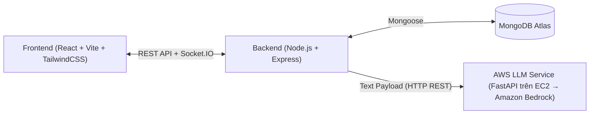

# Architecture & Shared Specification — AegisAI

Tài liệu này mô tả kiến trúc tổng thể, cấu trúc thư mục, biến môi trường và các quy ước dùng chung cho toàn bộ các module trong thư mục `docs/`.

## 1. Danh mục tài liệu Spec theo Module
- [`auth-spec.md`](auth-spec.md): Đăng ký, đăng nhập, JWT, phân quyền `user` / `admin`.
- [`chat-spec.md`](chat-spec.md): Chat 1-1 realtime (Socket.IO), upload ảnh, giải mã VietQR đa ngân hàng, interface mở rộng `ChatPartner`.
- [`ai-scam-detection-spec.md`](ai-scam-detection-spec.md): Luồng kiểm tra lừa đảo On-demand, Link Analyzer, Contract AI Service (Bedrock), 3 câu hỏi làm rõ & bảng trọng số.
- [`safety-admin-spec.md`](safety-admin-spec.md): Báo cáo, Chặn, Blacklist, Cảnh báo tự động, Trang Mẹo phòng chống & Admin Dashboard.
- [`practice-mode-spec.md`](practice-mode-spec.md): Chế độ luyện tập với chatbot mô phỏng (Mục 12 — mở rộng khi dư thời gian).
- [`aws-llm-service-spec.md`](aws-llm-service-spec.md): Đặc tả riêng cho `ai-service/` trên AWS (FastAPI + Amazon Bedrock, System Prompt chống Injection, Evaluation).
- [`ui-ux-spec.md`](ui-ux-spec.md): Quy chuẩn trạng thái UI (Loading/Empty/Blocked/Flagged), điều hướng và câu chữ tiếng Việt.
- [`theme.md`](theme.md): Theme chủ đạo toàn dự án (Màu thương hiệu, màu rủi ro AI, Typography, Tokens).
- [`testing-seed-spec.md`](testing-seed-spec.md): Đặc tả dữ liệu `seedDemo.js` (3 kịch bản chuẩn) và bộ Test Case E2E.

## 2. Tech Stack & Kiến trúc tổng thể



| Thành phần | Công nghệ |
|---|---|
| Frontend | React + Vite + TailwindCSS (`socket.io-client`, `axios`, `lucide-react`) |
| Backend | Node.js + Express + Socket.IO |
| Database | MongoDB (Mongoose + MongoDB Atlas) |
| AI Service | FastAPI trên AWS EC2 gọi LLM qua Amazon Bedrock (`boto3`) |

## 3. Cấu trúc thư mục dự án

```text
aegisai/
├── docs/                       # Toàn bộ spec theo từng module (AI-Driven Development)
├── server/                     # Backend Node.js (Express + Socket.IO + Mongoose)
│   ├── src/
│   │   ├── config/             # db.js, env.js, bankBins.json
│   │   ├── models/             # User.js, Message.js, Report.js, Block.js, Blacklist.js, ScamCheck.js
│   │   ├── middlewares/        # auth.js, adminOnly.js, upload.js, rateLimit.js
│   │   ├── services/           # qrParser, linkAnalyzer, llmClient, clarification, chatPartner
│   │   ├── routes/             # auth, chat, scamCheck, safety, admin
│   │   ├── sockets/            # chat.socket.js
│   │   ├── seeds/              # seedDemo.js
│   │   └── app.js
│   └── uploads/
├── client/                     # Frontend React + Vite + TailwindCSS
│   └── src/
│       ├── api/                # axiosInstance.js, socket.js
│       ├── context/            # AuthContext.jsx
│       ├── components/         # ChatWindow, MessageBubble, PrivacyConfirmModal, ScamResultModal...
│       └── pages/              # LoginPage, RegisterPage, ChatPage, HistoryPage, TipsPage, AdminPage
└── ai-service/                 # AWS LLM Service (FastAPI + Amazon Bedrock)
```

## 4. Biến môi trường (`.env`)

### `server/.env`
```env
PORT=5000
MONGODB_URI=mongodb+srv://<user>:<password>@cluster.mongodb.net/aegisai
JWT_SECRET=your_super_secret_jwt_key
CLIENT_URL=http://localhost:5173
AWS_LLM_API_URL=http://localhost:8000/analyze   # ai-service chạy chung EC2 với backend
AWS_LLM_API_KEY=internal_shared_secret_key
GOOGLE_SAFE_BROWSING_KEY=optional_api_key_here
```

### `client/.env`
```env
VITE_API_URL=http://localhost:5000/api
VITE_SOCKET_URL=http://localhost:5000
```

## 5. Seed Data chuẩn cho Demo (`seedDemo.js`)
- 1 tài khoản `admin` (`role: 'admin'`).
- 1 tài khoản `demo_user` (`role: 'user'`) để đăng nhập kiểm thử nhanh.
- 3 cuộc hội thoại mẫu có sẵn tin nhắn:
  1. **Rủi ro cao (>= 70đ):** `HoTro_MoMo_247` đòi OTP + link giả `http://m0mo-xacminh.xyz` + QR BIDV.
  2. **Vùng nghi ngờ (30–69đ):** `TuyenDung_CTV_Online` mời làm cộng tác viên, chưa rõ ràng -> kích hoạt 3 câu hỏi làm rõ.
  3. **An toàn (< 30đ):** `ChuTro_AnhMinh` nhắc đóng tiền trọ kèm QR Vietcombank.
