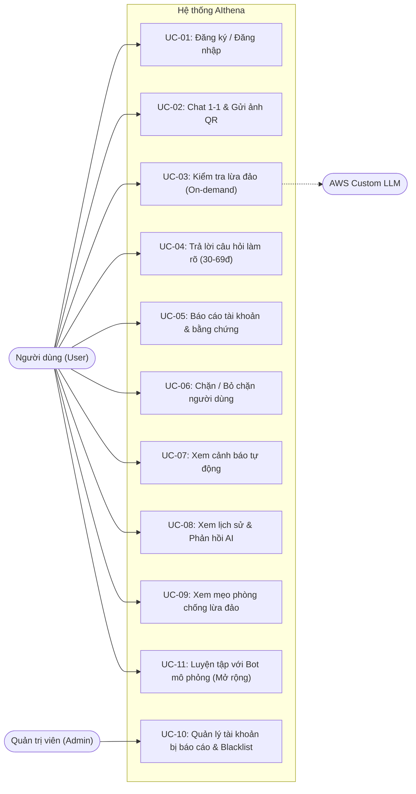

# Danh sách Use Case — AIthena

Tài liệu mô tả toàn bộ các Use Case của hệ thống **AIthena** phục vụ thiết kế và kiểm thử.

## 1. Các tác nhân (Actors)
- **Người dùng (User):** Người sử dụng ứng dụng chat và công cụ AI kiểm tra lừa đảo.
- **Đối phương (Peer):** Người dùng khác đang nhắn tin 1-1 với User.
- **Quản trị viên (Admin):** Người theo dõi các tài khoản/tài nguyên bị báo cáo nhiều lần và quản lý danh sách đen.
- **Hệ thống AI (AWS Custom LLM):** Dịch vụ mô hình ngôn ngữ lớn chạy trên AWS tiếp nhận dữ liệu đã tiền xử lý và trả về đánh giá rủi ro.

---

## 2. Sơ đồ tổng quan Use Case

---

## 3. Bảng tổng hợp Use Case

| Mã UC | Tên Use Case | Tác nhân chính | Độ ưu tiên | Mô tả ngắn |
|---|---|---|---|---|
| **UC-01** | Đăng ký & Đăng nhập | User, Admin | P0 (Bắt buộc) | Tạo tài khoản mới hoặc đăng nhập nhận JWT token để vào hệ thống chat. |
| **UC-02** | Chat 1-1 & Gửi ảnh QR | User, Peer | P0 (Bắt buộc) | Gửi/nhận tin nhắn văn bản và ảnh theo thời gian thực qua Socket.IO; tự động giải mã VietQR khi gửi ảnh. |
| **UC-03** | Kiểm tra lừa đảo (On-demand) | User, AWS LLM | P0 (Bắt buộc) | Người dùng bấm nút kiểm tra, xác nhận quyền riêng tư; hệ thống tiền xử lý Link/QR/Blacklist và gọi AWS LLM đánh giá. |
| **UC-04** | Trả lời câu hỏi làm rõ | User | P0 (Bắt buộc) | Khi điểm rủi ro từ 30–69, hiển thị tối đa 3 câu hỏi Có/Không/Không chắc để cập nhật điểm theo bảng trọng số. |
| **UC-05** | Báo cáo tài khoản | User | P0 (Bắt buộc) | Gửi báo cáo kèm lý do và tin nhắn bằng chứng; hệ thống tự động cộng số lần báo cáo và cập nhật Blacklist. |
| **UC-06** | Chặn / Bỏ chặn người dùng | User | P0 (Bắt buộc) | Ngăn chặn đối phương gửi tin nhắn mới tới mình qua Socket.IO. |
| **UC-07** | Cảnh báo tự động | User | P1 (Quan trọng) | Hiển thị nhãn cảnh báo khi đối phương có nhiều báo cáo hoặc tin nhắn chứa Link/QR nằm trong Blacklist. |
| **UC-08** | Lịch sử kiểm tra & Phản hồi AI | User | P1 (Quan trọng) | Xem lại các kết quả kiểm tra cũ và đánh dấu AI nhận diện Đúng / Sai. |
| **UC-09** | Xem mẹo phòng chống lừa đảo | User | P1 (Quan trọng) | Đọc trang hướng dẫn nhận biết các chiêu trò lừa đảo phổ biến tại Việt Nam. |
| **UC-10** | Quản trị báo cáo & Blacklist | Admin | P1 (Quan trọng) | Xem danh sách tài khoản, số tài khoản ngân hàng, link bị báo cáo nhiều lần; xác nhận hoặc gỡ khỏi Blacklist. |
| **UC-11** | Luyện tập mô phỏng lừa đảo | User | P2 (Mở rộng) | Chat thử với Bot đóng vai kẻ lừa đảo theo kịch bản để rèn luyện kỹ năng nhận biết. |

---

## 4. Đặc tả chi tiết các Use Case trọng tâm

### UC-02: Chat 1-1 & Gửi ảnh (Giải mã VietQR)
- **Tiền điều kiện:** Người dùng đã đăng nhập và không nằm trong danh sách chặn nhau (`blocks`).
- **Luồng chính:**
  1. Người dùng chọn một người trong danh sách để mở khung chat 1-1.
  2. Nhập văn bản hoặc chọn file ảnh (VD: ảnh mã QR chuyển khoản BIDV, MBBank, Vietcombank, MoMo...) để gửi.
  3. Nếu gửi ảnh, Backend nhận file, dùng `jimp` + `jsqr` trích xuất chuỗi QR và chạy bộ parser EMVCo/VietQR để lấy `bankName`, `accountNumber`, `amount`, `purpose`.
  4. Backend lưu tin nhắn vào MongoDB (`messages`) và phát sự kiện `receive_message` qua Socket.IO cho cả 2 bên.
- **Luồng ngoại lệ:** Nếu một trong hai người đã chặn người kia, hệ thống từ chối gửi tin và báo lỗi trên giao diện.

### UC-03: Kiểm tra lừa đảo (On-demand)
- **Tiền điều kiện:** Cuộc hội thoại có ít nhất 1 tin nhắn.
- **Luồng chính:**
  1. Người dùng bấm nút **"Kiểm tra lừa đảo"** trên thanh tiêu đề cuộc trò chuyện.
  2. Hệ thống hiển thị thông báo: *"Nội dung 20-30 tin nhắn gần nhất sẽ được gửi tới hệ thống AI để phân tích tham khảo. Bạn có đồng ý?"*.
  3. Người dùng bấm **Xác nhận**.
  4. Backend lấy tối đa 30 tin nhắn gần nhất, chạy bộ phân tích Link (Heuristic + Safe Browsing fallback), đọc dữ liệu `qrData` đã trích xuất, đối chiếu `blacklist` và `reportCount`.
  5. Backend đóng gói thành Text Payload (bọc tin nhắn chống Prompt Injection) và gọi `POST <AWS_LLM_URL>/analyze`.
  6. Backend nhận JSON từ AWS LLM, lưu vào `scam_checks` và trả về Frontend:
     - **Điểm < 30:** Hiển thị thẻ xanh "Chưa phát hiện dấu hiệu lừa đảo".
     - **Điểm 30 – 69:** Chuyển sang **UC-04** (hiện tối đa 3 câu hỏi làm rõ).
     - **Điểm >= 70 (hoặc trúng Blacklist):** Hiển thị cảnh báo đỏ, trích dẫn câu nghi ngờ, lời khuyên, kèm nút **"Chặn & Báo cáo ngay"** và nút **"Tôi đã kiểm tra và vẫn muốn tiếp tục"** (có đếm ngược ngắn).
- **Luồng ngoại lệ:** Nếu AWS LLM timeout hoặc lỗi kết nối, hệ thống trả về kết quả đánh giá sơ bộ dựa trên Heuristic Link/Blacklist và thông báo AI tạm thời gián đoạn.

### UC-04: Trả lời câu hỏi làm rõ (Vùng 30 – 69 điểm)
- **Tiền điều kiện:** Kết quả `initialScore` từ UC-03 nằm trong khoảng `30..69`.
- **Luồng chính:**
  1. Hệ thống hiển thị lần lượt hoặc danh sách tối đa 3 câu hỏi kiểm chứng được (VD: *"Họ có tự xưng công ty nhưng yêu cầu chuyển vào tài khoản cá nhân?"*).
  2. Người dùng chọn `Có` / `Không` / `Không chắc` cho từng câu.
  3. Frontend gửi các câu trả lời về `POST /api/scam-check/:id/clarify`.
  4. Backend cộng/trừ điểm theo bảng trọng số cố định, lưu `finalScore` và lý do thay đổi điểm (VD: *"Điểm tăng từ 52 lên 77 vì đối phương yêu cầu chuyển vào tài khoản cá nhân"*).
  5. Giao diện cập nhật lại kết luận cuối cùng; nếu vẫn ở mức 30–69, gợi ý hành động xác minh ngoài cuộc chat (gọi số tổng đài/người quen đã lưu).

### UC-05: Báo cáo tài khoản & Cập nhật Blacklist
- **Luồng chính:**
  1. Người dùng bấm **Báo cáo**, chọn lý do (`giả danh`, `việc làm online`, `đầu tư`, `phishing`, `khác`), nhập mô tả và chọn các tin nhắn làm bằng chứng.
  2. Backend lưu vào `reports`, tăng `reportCount` của `reportedUserId`. Nếu `reportCount >= 3`, tự động bật `isFlagged = true`.
  3. Nếu tin nhắn bằng chứng chứa Link hoặc Số tài khoản QR, hệ thống tự động thêm/tăng `reportCount` cho đối tượng đó trong `blacklist`.

### UC-10: Quản trị báo cáo & Blacklist (Admin)
- **Tiền điều kiện:** Tài khoản đăng nhập có `role === 'admin'`.
- **Luồng chính:**
  1. Admin truy cập trang `/admin`.
  2. Hệ thống hiển thị 2 bảng: **Tài khoản bị báo cáo nhiều lần** (sắp xếp theo `reportCount` giảm dần) và **Danh sách Blacklist** (Link / Số tài khoản ngân hàng).
  3. Admin có thể bấm xem chi tiết bằng chứng từ `reports`, bấm **"Xác nhận Blacklist"** (`status: 'confirmed'`) hoặc **"Gỡ cảnh báo"** nếu báo cáo sai.
